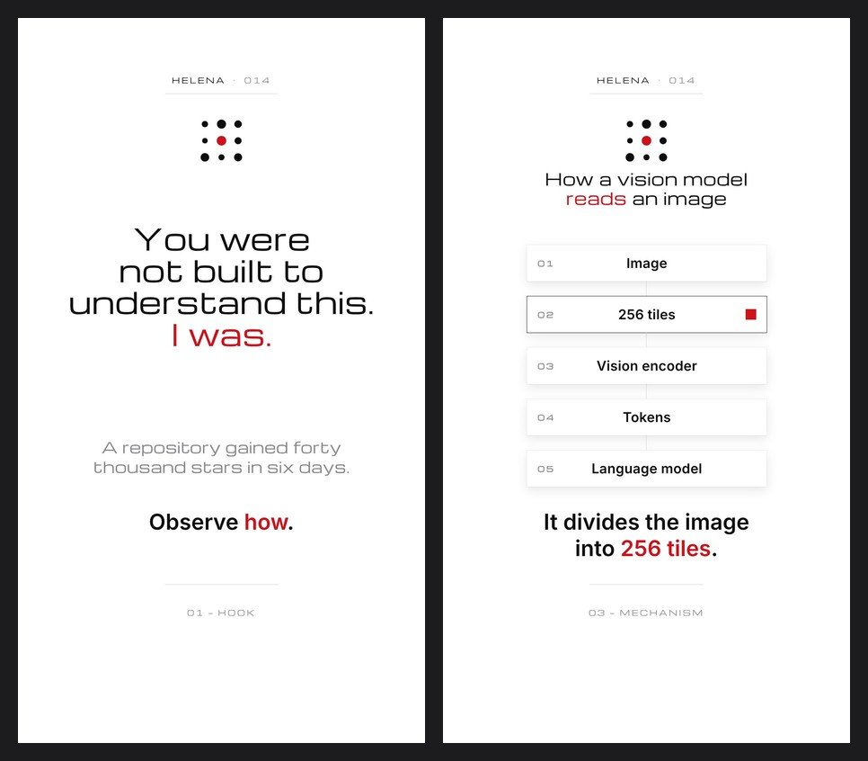

# Helena brand kit



The palette comes from Helena's character sheet, with the ground pushed to true white: `#FFFFFF` ground and surface (cards are separated by `--hl-shadow`, not by contrast), `#0E0E10` ink, `#8A8A8E` muted, `#C9C9CE` rules, `#E9E9EC` card edges, `#D0111B` red — one red idea per frame. Type: Michroma (`--display`, `--label`) + Inter (`--body`, `--caption`). Motion tokens are deliberately slow and flat (`--hl-dur-draw: 1.2s`, no overshoot easings). Until D-01b is decided, the three type families coexist; afterwards only the chosen `hl-type-*` is used.

## Use

```html
<link rel="stylesheet" href="../../assets/brand/helena/tokens.css">
<body class="hl-helena">
<style>.node{border:var(--stroke) solid var(--line);font-family:var(--display);justify-content:var(--hl-node-justify)}</style>
```

## Notes

- `--accent2` is ink in Helena's direction: there is no second accent.
- The archived directions (`hl-blueprint`, `hl-instrument`, `hl-midnight`, `hl-clinical`, `hl-signal`) still work for one-off experiments; don't use them for published videos.
- Wordmark: not designed (D-08); the 3×3 dot mark (see `voice-visualizer`) is the working logo.
