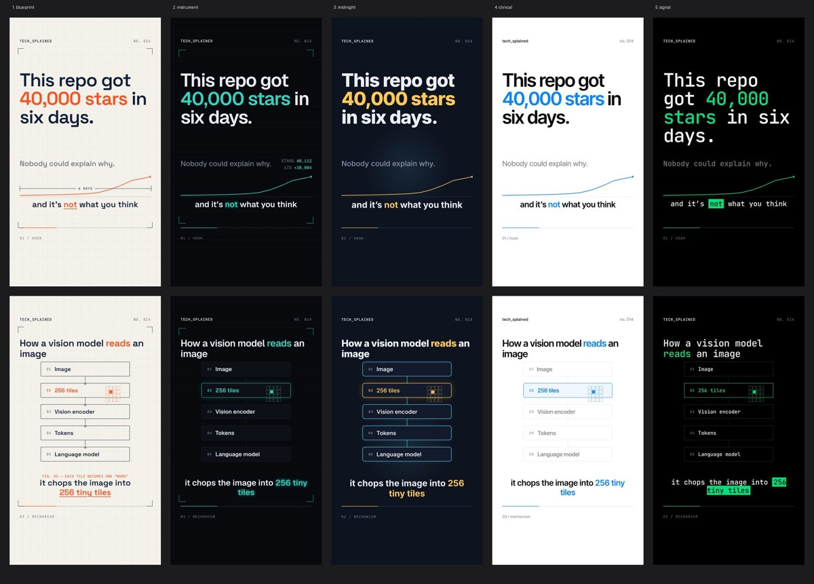

# tech_splained brand kit



Five token sets, one per candidate direction, plus the layout tokens every composition shares (safe area, caption size/position, type scale, easing/durations). Until the decision log marks a direction as chosen, compositions may use any of them for A/B tests; afterwards, only the chosen one (the others stay for reference).

## Use

```html
<link rel="stylesheet" href="../../assets/brand/techsplained/tokens.css">
<body class="ts-instrument">
<style>.node{border:var(--stroke) solid var(--line);border-radius:var(--radius);font-family:var(--display)}</style>
```

## Notes

- One accent per video: `--accent` only. `--accent2` is reserved for a second semantic meaning (a warning, a "before" state) and most videos never need it.
- Contrast: every `--text`/`--bg` pair is ≥ 16:1; `--accent` on `--bg` is ≥ 4.5:1 in every direction except clinical's blue on white, which is borderline — in clinical, highlighted caption words use the accent but body caption text stays `--text`.
- Wordmark/logo: not designed yet (see decision log).
