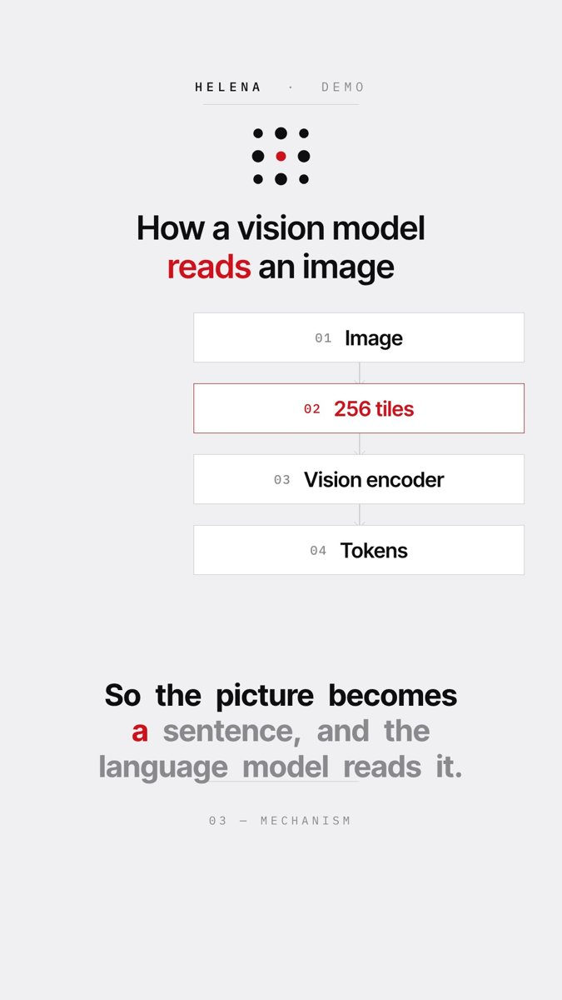

# Word-synced captions



Lines are declared as `from`/`to` phrases and resolved **in order** against the narration (so repeated words like "so" land on the right line). The line is shown from its first word to 0.35 s after its last; the spoken word takes `--accent`, words in `accent[]` stay accented once spoken, upcoming words sit at `--muted`.

## Use

```js
const C = GML.captions.create(document.getElementById("captions"), { narration: N, lines: [
  { from: "So", to: "tiles,", accent: ["tiny", "tiles"] },
  { from: "like", to: "pieces.", accent: ["puzzle"] },
]});
// in render(t): C.render(t);
```

## Notes

- Position/size come from `--hl-caption-y`, `--hl-caption-size`, `--hl-caption-weight` in the brand tokens (y 1300, 60 px, 700 by default).
- `pill: true` wraps the line in an 82 %-opaque pill of the ground colour — use only when a caption overlaps a diagram.
- Keep lines ≤ 8 words (≤ 22 characters per visual line in mono directions). The QA readability rule (≥ 0.3 s/word) is checked downstream.
