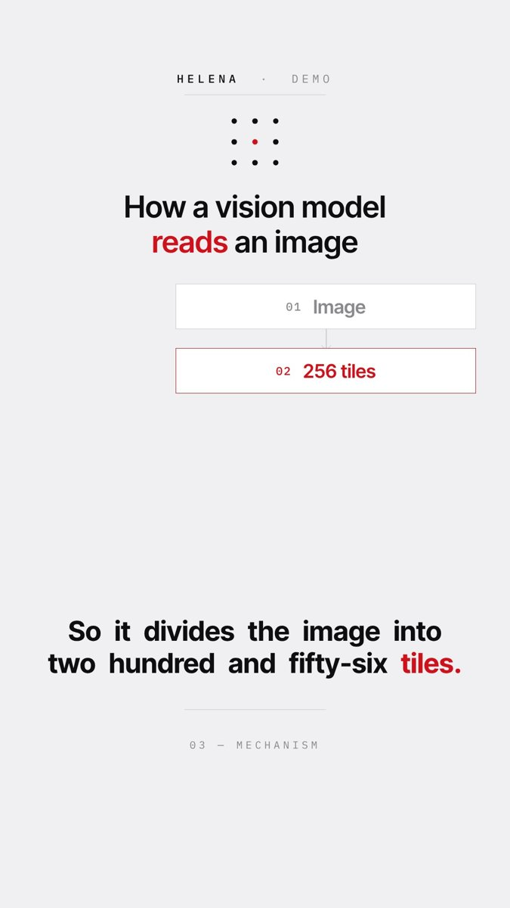

# Pipeline primitive



Five 104-px stages fit between y 470 and 1250 with a 48-px gap; for more stages, zoom (see the storytelling doc) rather than shrinking. Reads only brand tokens, so it renders correctly in every direction.

## Use

```js
const P = GML.pipeline.create(fig, { steps: [{ label: "Image" }, { label: "256 tiles" }, { label: "Vision encoder" }, { label: "Tokens" }, { label: "Language model" }] });
// render(t):
P.render(t, { reveal: [N.at("picture"), N.at("chops"), N.at("puzzle"), N.at("number"), N.at("language")],
              highlight: 1, highlightAt: N.at("tiles"), packet: pk /* 0..1 or null */, dimOthers: true });
```

## Notes

- Children appended to a node (e.g. a tiles grid) ride along with it; set their own opacity from `render`.
- Not built yet: horizontal variant, branching (use `diagram-graph` when it exists), per-stage sub-labels.
