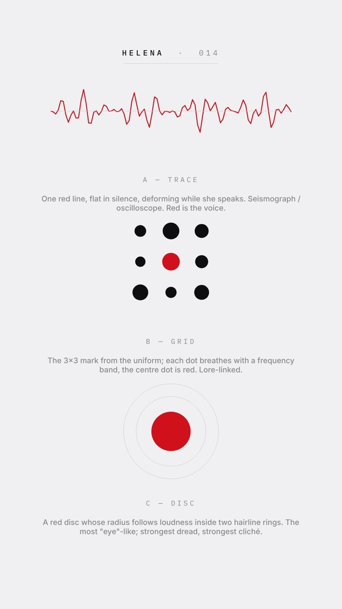

# Voice visualizer



Helena never appears in a video; this is how the viewer knows she's there. The style is a D-01c decision (grid / trace / disc); until decided, compositions pass it explicitly.

## Use

```bash
python3 assets/tools/narration/levels.py Project_Files/narration.wav Project_Files/levels.json   # 50 Hz, 3 bands, normalised
```
```html
<script src="levels.json.js"></script>
<script>
  const V = GML.visualizer.create(stage, { style: "grid", levels: window.LEVELS, narration: N, x: 540, y: 300 });
  // render(t): V.render(t);
</script>
```

## Notes

- With stub narration (no audio) it animates while a word is "being spoken" so storyboards still show it moving.
- Keep it at the top centre (y ≈ 270–300) under the meta line; it must stay inside the safe area and never overlap captions.
- Motion is driven by audio only — never by the music's beat grid.
