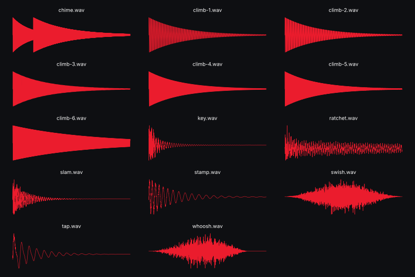

# Key-tunable SFX kit



Needs Python 3 with numpy + scipy. Every sound is generated, so tonal ones sit on the song's root / fifth / minor pentatonic instead of clashing with it.

| File | Use |
| --- | --- |
| `whoosh` | screen push / slide (0.2–0.3 gain) |
| `tap` | on-screen press (render-pipeline's sfx-tap recipe, body on the root) |
| `key` | typing — one per digit |
| `chime` | two-step blip, root → fifth (a reveal, an icon pop) |
| `climb-1` … `climb-6` | rising blips, one per step of a climb (e.g. a PWR class-up); `climb-6` rings longer |
| `ratchet` | detents on a drag (e.g. every 0.5° on the camber ruler) |
| `swish` | page sheet up / down |
| `slam` | heavy door / panel slam with a clank on the root |
| `stamp` | sticker / stencil text landing |

## Use

```bash
python3 assets/tools/sfx-kit/sfx.py work/SFX --root F                 # root = the song's tonal centre (the music asset says it)
node assets/tools/sfx-kit/cues.mjs cues.mjs work/SFX                  # → --sfx work/SFX/tap.wav@2.544@0.45 …
bash assets/tools/render-pipeline/audio.sh song.mp3 94.843 20.3 mix.wav --fade-out 0.8 $(node assets/tools/sfx-kit/cues.mjs cues.mjs work/SFX)
```
```js
// cues.mjs — derive cue times from the same timeline the composition uses
import { createRequire } from "node:module"; const T = createRequire(import.meta.url)("./timeline.js");
export default [["tap", T.tapChip, 0.45], ...T.hpKeys.map((t) => ["key", t, 0.42]), ["slam", T.door.slam, 0.6]];
```

## Notes

- Over a dense track keep gains at 0.2–0.45 (slam ~0.6); audio.sh then levels the mix to about −14 LUFS.
- `--root` takes C … B with # or b (e.g. `F#`, `Bb`).
