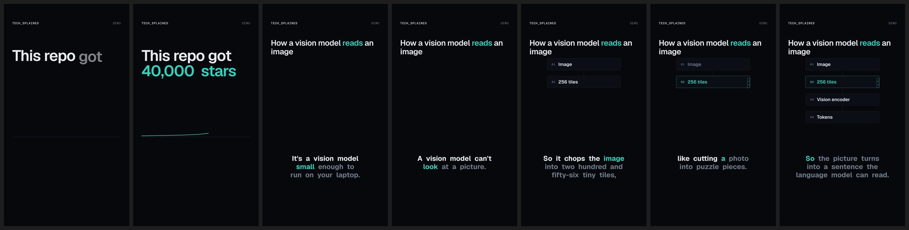

# explainer-demo

A working 9:16 composition built only from library assets: hook words set in as they're spoken, a sparkline draws on "stars", the pipeline primitive reveals stage by stage on narration words, the highlight lands on "tiles", a packet travels on "sentence", captions follow the voice throughout. Timings come from `narration.json` — here a **stub** from `stub-narration.py` (no audio); swap in a real `narration.json` from one of the TTS runners and the video re-times itself.



```bash
P=assets/tools/render-pipeline
python3 assets/tools/narration/stub-narration.py examples/explainer-demo/script.txt examples/explainer-demo/narration.json
node $P/capture.mjs examples/explainer-demo/demo.html stills /tmp/demo-stills 1 2.6 8.5 13.5 17 21 28 --query dir=instrument
node $P/capture.mjs examples/explainer-demo/demo.html frames /tmp/demo-frames --query dir=blueprint     # any of the five directions
```
